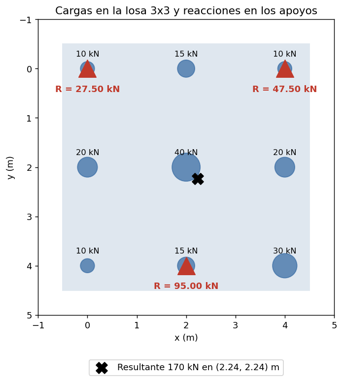
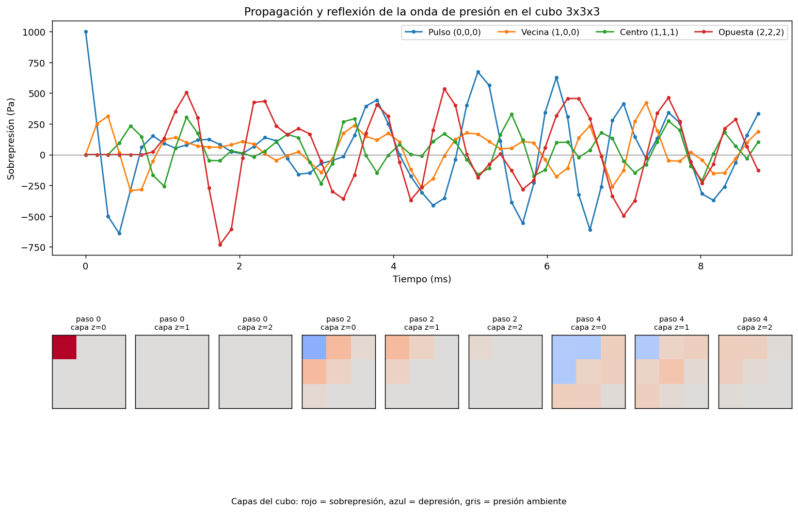
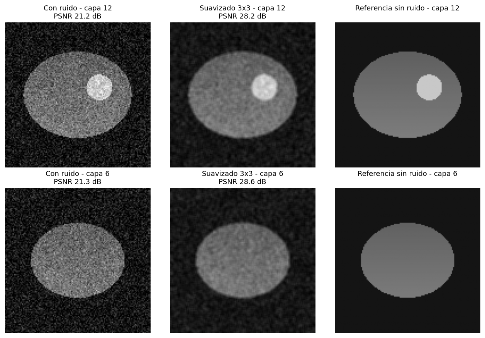
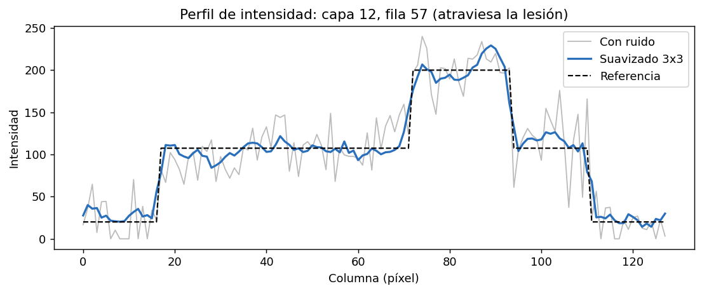
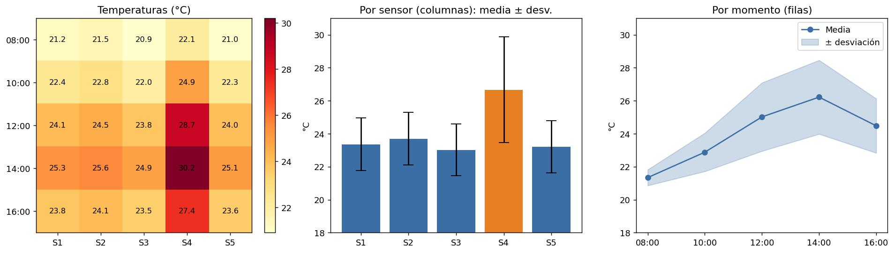
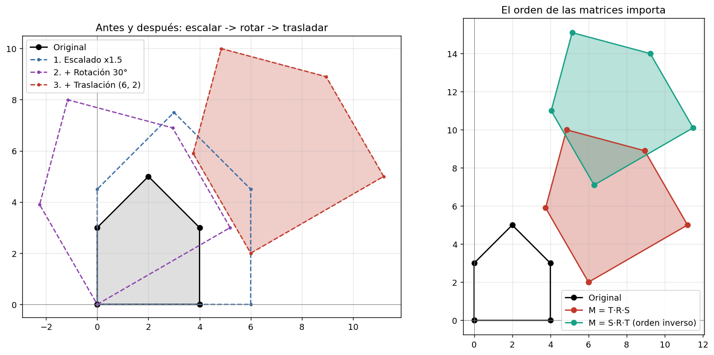

# Arreglos multidimensionales en problemas de ingeniería

**Tema 5:** Arreglos y tipos abstractos de datos (Parte 2)
5.3 Arreglos multidimensionales: definición y aplicaciones · 5.4 Aplicaciones prácticas: manejo de datos en tablas y matrices

Cinco problemas de ingeniería resueltos en **Python** con arreglos de 2, 3 y 4 dimensiones de **NumPy**:

| # | Problema | Arreglo principal | Forma |
|---|---|---|---|
| 1 | Fuerzas en una estructura | Matriz de cargas por nodo | `(3, 3)` |
| 2 | Fluido en una cuadrícula 3D | Estado del fluido por celda | `(3, 3, 3, 5)` |
| 3 | Imágenes médicas 3D | Volumen de capas 2D | `(24, 128, 128)` |
| 4 | Tabla de sensores | Momentos × sensores | `(5, 5)` |
| 5 | Transformación de coordenadas | Puntos (x, y) | `(N, 2)` |

---

## Estructura del repositorio

```
├── main.py                        # ejecuta todos los problemas (o uno: python main.py 3)
├── utils.py                       # guardado de figuras y encabezados
├── problema1_estatica.py
├── problema2_fluido3d.py
├── problema3_imagenes_medicas.py
├── problema4_sensores.py
├── problema5_transformaciones.py
├── resultados/                    # gráficas generadas
└── requirements.txt
```

## Cómo ejecutar

```bash
pip install -r requirements.txt
python main.py          # los 5 problemas
python main.py 3        # solo el problema 3
```

Cada script también se puede ejecutar por separado (`python problema4_sensores.py`). Los resultados se imprimen en la consola y las gráficas se guardan en `resultados/`.

---

## Enfoque general y su efecto en la eficiencia

**1. Arreglos de NumPy en lugar de listas anidadas.** Un `np.ndarray` guarda los números en un bloque **contiguo** de memoria, con un tipo fijo (8 bytes por `float64`). Una lista de listas de Python guarda referencias a objetos dispersos en memoria: unos 24 bytes por número más 8 bytes del puntero. Esto reduce la memoria y aprovecha la caché del procesador.

**2. Vectorización.** Las operaciones se escriben sobre el arreglo completo (`fuerzas * X`, `tabla.mean(axis=0)`, `puntos @ M.T`) en lugar de con bucles de Python. El recorrido elemento por elemento lo hace NumPy en código C compilado. En el Problema 3 se midió: **el filtro vectorizado es unas 270 veces más rápido** que la versión con 4 bucles anidados, con el mismo resultado.

**3. Vistas en lugar de copias.** Expresiones como `estado[..., P]` o `padded[:, di:di+alto, dj:dj+ancho]` son **vistas**: apuntan a los mismos datos sin duplicarlos.

**4. El eje como parámetro.** En un arreglo multidimensional, la misma operación sirve para filas o columnas cambiando `axis`, sin escribir dos bucles distintos (Problema 4).

---

## Problema 1: Análisis de fuerzas en una estructura

**Planteamiento.** Una losa rígida con 9 nodos en una cuadrícula 3×3, separados 2 m. La matriz `FUERZAS[i][j]` contiene la carga vertical (kN) en cada nodo. La losa se apoya en **3 columnas no alineadas**, así que el problema es estáticamente determinado: 3 incógnitas y 3 ecuaciones de equilibrio.

| Ecuación | Forma |
|---|---|
| ΣFz = 0 | R₁ + R₂ + R₃ = ΣF |
| ΣMy = 0 | R₁x₁ + R₂x₂ + R₃x₃ = Σ F·x |
| ΣMx = 0 | R₁y₁ + R₂y₂ + R₃y₃ = Σ F·y |

**Solución.** `np.meshgrid` crea dos matrices `X` e `Y` con la posición de cada nodo. Los momentos se calculan como productos **elemento a elemento** de matrices (`(FUERZAS * X).sum()`). El sistema se arma como `A·R = b` (una matriz 3×3) y se resuelve con `np.linalg.solve`. Antes se verifica que `det(A) ≠ 0`, es decir, que los apoyos no estén alineados.

**Resultado.** Para 170 kN de carga total: R = **27.5, 47.5 y 95.0 kN**. El residuo del equilibrio es 0.

**Eficiencia.** Calcular los momentos es O(n) sobre los nodos y se resuelve con una sola expresión vectorizada. Resolver el sistema con `solve` (factorización LU) es más estable y rápido que calcular la inversa `A⁻¹·b`.



---

## Problema 2: Simulación de un fluido en una cuadrícula 3D

**Planteamiento.** Un único arreglo de **4 dimensiones** `estado[x, y, z, campo]` con forma `(3, 3, 3, 5)`. Cada celda del cubo 3×3×3 guarda su **presión, temperatura y velocidad (vx, vy, vz)**. Se aplica un pulso de presión de 1000 Pa en una esquina y se simula su propagación.

**Modelo (acústica lineal):**
- **Presión:** ecuación de onda discreta, `p(t+1) = 2p(t) − p(t−1) + (c·dt)²·∇²p`. El Laplaciano de cada celda usa sus **6 vecinas** (±x, ±y, ±z).
- **Velocidad:** ecuación de Euler linealizada, `dv/dt = −∇p / ρ`.
- **Temperatura:** compresión adiabática, `T = T₀·(p/p₀)^((γ−1)/γ)`.
- **Paredes rígidas:** la onda se refleja, porque `np.pad(mode="edge")` hace que la vecina fuera del borde sea la propia celda, y la velocidad perpendicular a cada pared es cero.
- **Estabilidad:** el número de Courant c·dt/dx = 0.5 está por debajo del límite 3D de 1/√3 ≈ 0.577.

**Resultado.** La onda avanza en diagonal: llega a la celda vecina en el paso 1, al centro en el paso 3 y a la esquina opuesta en el paso 6. Después se refleja en las paredes. La **presión media se conserva** (variación de ~10⁻¹⁰ Pa), lo que comprueba que las paredes no dejan escapar energía.

**Eficiencia.** El Laplaciano se calcula **para todas las celdas a la vez** con 6 desplazamientos del arreglo, en lugar de 3 bucles anidados × 6 vecinas. Guardar los 5 campos en la última dimensión deja juntos en memoria todos los datos de una celda. Además, `estado[..., P]` da una vista de solo la presión, sin copiarla. El código es el mismo para una cuadrícula de 3×3×3 o de 100×100×100.



---

## Problema 3: Suavizado de imágenes médicas 3D

**Planteamiento.** El volumen es un arreglo 3D `(capas, alto, ancho)`, donde cada `volumen[k]` es un corte 2D del órgano. Como no se usan datos de pacientes, se genera un **volumen sintético**: un órgano elipsoidal con una lesión esférica y ruido gaussiano (σ = 25). Tener la imagen limpia permite **medir** la mejora.

**Solución.** Un filtro de promedio 3×3 aplicado a cada capa: cada píxel se reemplaza por la media de su vecindario. Hay dos implementaciones:
- `filtro_promedio_bucles`: 4 bucles anidados (fila, columna, di, dj). Es didáctica y sirve como referencia.
- `filtro_promedio_volumen`: vectorizada. Rellena solo los ejes de alto y ancho, así que cada capa se filtra de forma independiente, y suma 9 desplazamientos del volumen **completo**.

**Resultado.**

| Imagen | PSNR (dB) | Ruido en tejido (σ) |
|---|---|---|
| Con ruido | 21.37 | 25.00 |
| Promedio 3×3 | 28.90 | 10.92 |
| Promedio 5×5 | 29.80 | 10.49 |
| Promedio 7×7 | 29.32 | 11.42 |

El filtro 3×3 **reduce el ruido a menos de la mitad** (+7.5 dB de PSNR). Agrandar la ventana tiene un límite: el 5×5 da el mejor equilibrio, pero el 7×7 ya empeora porque difumina los bordes del órgano y de la lesión.

**Eficiencia (medida).**

| Versión | Tiempo |
|---|---|
| Bucles anidados | ~28 ms por capa (~0.7 s para las 24 capas) |
| Vectorizada | ~2.5 ms para **todo** el volumen |

La versión vectorizada es unas **270 veces más rápida** y da el mismo resultado (verificado con `np.allclose`). La versión con bucles ejecuta capas × alto × ancho × 9 ≈ 3.5 millones de operaciones interpretadas por Python. La vectorizada hace 9 sumas de arreglos en C. Ambas son O(capas·alto·ancho·k²), pero la diferencia en la constante es enorme.




---

## Problema 4: Manejo de datos en una tabla de sensores

**Planteamiento.** Una matriz 5×5 de temperaturas: las **filas** son momentos del día (08:00 a 16:00) y las **columnas** son sensores (S1 a S5).

**Solución.** Las estadísticas por sensor y por momento son la **misma llamada cambiando el eje**:
```python
TEMPERATURAS.mean(axis=0), TEMPERATURAS.std(axis=0, ddof=1)   # por columna (sensor)
TEMPERATURAS.mean(axis=1), TEMPERATURAS.std(axis=1, ddof=1)   # por fila (momento)
```
Se usa la desviación estándar **muestral** (`ddof=1`), porque son 5 mediciones de una población mayor.

**Resultado.** La consola muestra la tabla con las estadísticas en los márgenes. **S4 tiene el doble de variabilidad** que los demás (σ = 3.21 °C frente a ~1.59 °C): está cerca de una ventana con sol directo. Las 14:00 son el momento más caluroso (26.2 °C de media), y también el de mayor dispersión entre sensores, por el efecto de S4.

**Eficiencia.** Cada estadística recorre la tabla una sola vez en C. Para 5×5 la diferencia es mínima, pero el mismo código escala sin cambios a miles de sensores y millones de lecturas.



---

## Problema 5: Transformación de coordenadas

**Planteamiento.** Los puntos de una figura (una casa) se guardan en un arreglo `(N, 2)`, una fila por punto.

**Solución.** Se usan **coordenadas homogéneas** `(x, y, 1)`, con las que escalado, rotación y traslación son matrices 3×3. Así se **componen en una sola matriz**:

```
M = T · R · S        (escalar ×1.5 → rotar 30° → trasladar (6, 2))
```

Transformar todos los puntos es **una única multiplicación**: `(N×3) · (3×3)ᵀ`.

**Verificaciones automáticas:**
- Aplicar `M` de una vez da lo mismo que aplicar S, R y T por separado.
- Las longitudes se multiplican por 1.5 (la escala). Rotar y trasladar no deforman la figura.
- El área se multiplica por 2.25, que es igual a `det(M)`.
- La gráfica de la derecha muestra que **el orden importa**: `T·R·S ≠ S·R·T`.

**Eficiencia.** Componer las transformaciones primero reduce el trabajo: en lugar de 3 pasadas sobre los N puntos (3·N productos), se hacen 2 productos 3×3 y **una sola pasada** sobre los N puntos. Con miles de puntos (gráficos, CAD, robótica) la diferencia es importante, y la multiplicación matricial de NumPy usa rutinas BLAS optimizadas.


